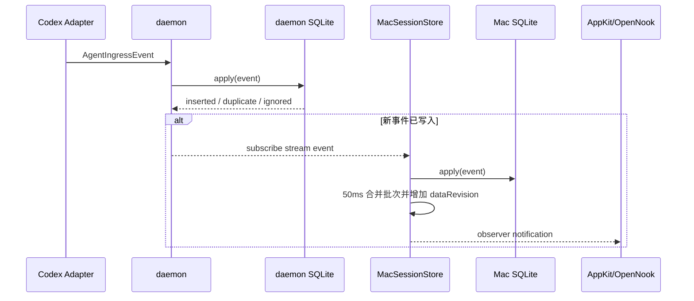
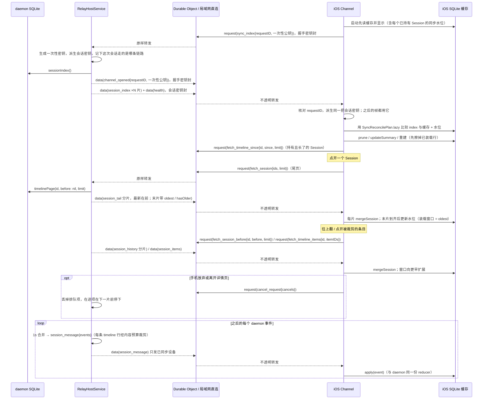

# 数据、通信与保存设计

daemon 保存本机权威 Session，也是唯一的数据源；Mac 经 IPC、iPhone 经 Relay 各自建立 SQLite 缓存（三端同一 schema），都用“index 对账 + 事件流”收敛。Relay 只保存路由与授权元数据。

## 统一业务模型

> 两层模型：**Agent 领域**（`SessionSummary` / `TurnSummary` / `TimelineItem`；summary 与 timeline 落库，`TurnSummary` 由 `TurnProjection` 读时投影）与 **Timeline 领域**（`TimelineRow`：tag L1/L2/L3、lane、status，由 `TimelineProjection.rows(from:)` 纯函数投影，不落库）。详见 [Session Timeline 重构方案](session-timeline-redesign.md)。

跨进程和跨设备模型由 `Transport` 唯一声明：

- `SessionSummary`：Agent、标题、工作目录、生命周期、Turn 阶段、时间、注意力 / 待查看标记（`needsAttention` / `needsReview`）、Notch 归档标记（`hiddenInNotch`：只把 Session 从 Notch 隐藏，Mac / iOS 照常显示；新 prompt 或会话重启时清除）、过滤判定标记（`hiddenByFilter` + 闩 `filterEvaluated`：daemon 在 Session 首条用户消息（按消息分类判定，含斜杠命令这类不开 Turn 的记录）到达时按过滤规则判一次并冻结，之后规则改动、复活、reingest 都不改它；闩区分「判过没命中」与「还没判」；Mac / Notch 读时隐藏——隐藏父 Session 连同其 Subagent 组传递性隐藏——Relay 全口径扣留使数据不进 iPhone；镜像的 reducer 只 sticky 携带，从不重算）、可选 Subagent lineage，以及 `firstTurnAt`（首个 Turn 时间；`isProvisional = lifecycle == starting && firstTurnAt == nil` 表示"第一个 Turn 之前的临时会话"，UI 不显示）。
- `SessionDetail`：一个 Summary、完整或分页 Timeline、下一页游标。
- `TimelineItem`：稳定 ID、Session ID、可选 Turn ID、时间和 payload。
- `TimelinePayload`：消息、reasoning、工具、计划、子 Agent、错误、上下文（session / turn）、session marker、turn end、模型配置、内部上下文、消耗指标。
- `AgentIngressEvent`：Adapter 输出的归一化事件，是 reducer 的唯一输入。可选 `disposition: .discard` 表示 helper 判定该 Session 不应保留（Claude 在第一个 Turn 前结束）：仓库删除 + 写墓碑，事件照常发布让所有镜像收敛。

生命周期和 Turn 阶段分开：

| 维度 | 当前值 |
| --- | --- |
| Session lifecycle | Starting、Running、Waiting For Input、Compacting、Completed、Failed、Interrupted |
| Turn phase | Idle、Thinking、Executing、Responding、Waiting For Approval、Subagent Running、Compacting |
| Agent kind | Codex、Codex Subagent、Claude、Claude Subagent |

枚举不设未知兜底：helper、daemon、Mac、iOS 一起发布，解码遇到不认识的值是要修的错误，不是要保留的原始字符串。模型配置、内部上下文和消耗指标作为结构化 Timeline payload 持久化并进入完整快照，Mac 的 Session 详情 Inspector 与 iOS 详情的 Info Tab 展示这些诊断类 payload（两端共用同一份 presentation），活动列表仍会过滤；同一 Session 的同类诊断 payload 只保留最新记录。

## 数据拥有者

| 位置 | 数据角色 | 保存内容 | 默认路径或介质 |
| --- | --- | --- | --- |
| Codex state | 外部只读元数据源 | Thread 标题、主 Session / Subagent 类型和 lineage；不复制整张表 | `${CODEX_HOME:-~/.codex}/state_5.sqlite` 的 `threads` |
| daemon | 本机权威 | Session、Timeline、已处理事件、rollout 游标、删除 tombstone、基线标记、Usage 桶、daemon 设置（`settings` 表，见下） | `~/Library/Application Support/Lumi/Lumen/sessions.sqlite3` |
| Mac App | 同步缓存 | daemon 当前 Session 与 Timeline 的镜像行（按内容预算裁剪，见「镜像行」） | `~/Library/Application Support/Lumi/Storage/session-cache.sqlite`（之前的 `Storage/cache.sqlite` 与更早的 `Mac/sessions.sqlite3` 存的是完整行，启动时删除，对账重建） |
| iOS App | 每 Mac SQLite 缓存 | 对应 Mac 的 Session 与 Timeline 的镜像行，外加用户点开取回的完整行（与 daemon 同一 schema） | `~/Library/Application Support/Lumi/Channels/<hostID>.sqlite3`（App 容器内） |
| daemon Keychain | 远程身份 | Relay URL、Host ID、Host secret、Host 密钥对 | service `app.huanan.lumi.daemon.relay`（account `host-credentials-v2`，由 daemon 自己创建） |
| daemon 状态文件 | 发送序号与设备信任 | 每个 Device ID 的 Host 发送序号（发送前先落盘）、被信任设备的公钥（Match 时钉住、Revoke 时去掉，daemon 判断信任只读这里）、本机撤销记录；先写盘后生效 | `~/Library/Application Support/Lumi/Lumen/relay-host-state.json`（0600） |
| iOS Keychain | 通道身份 | 每台 Mac 各自的 Relay URL、Host/Device ID、Device token、设备密钥对、Host 公钥、配对时间 | service `app.huanan.lumi.ios.relay`（account `device-channels-v4`） |
| Durable Object SQLite（`HostRelay`） | 运维元数据 | Host token hash、设备（公钥、token hash、配对 / 撤销时间）、配对会话（state、承诺、双方公钥与名称、揭示后的 nonce、签发的 Device token）、限流、每设备 Host 序号 | 每个 HostID 一个对象 |
| Durable Object SQLite（`PairingDirectory`） | 配对码目录 | SHA-256(配对码) → Host / 会话、到期与消费时间、claim 限流 | 全局一个对象 |

Keychain 项使用 `AfterFirstUnlockThisDeviceOnly`，不会随常规设备备份迁移。

## GRDB Schema

daemon、Mac 和 iOS 复用同一个 `SQLiteSessionRepository` migration（iOS 每台 Mac 一个文件，schema 完全一致）：

| 表 | 用途 | 关键规则 |
| --- | --- | --- |
| `sessions` | 当前 Session Summary | `id` 主键；按 `last_activity_at` 倒序读取 |
| `timeline` | Timeline item（Agent 领域消息） | `id` 主键；Session 外键级联删除；按时间与 ID 排序；跨来源同 ID 按「同 ID 取舍」覆盖 |
| `processed_events` | 幂等键 | 同一个 Event ID 只应用一次 |
| `rollout_cursors` | JSONL 增量位置 | 保存文件路径、byte offset、文件大小和 Session ID |
| `ignored_sessions` | 删除/基线/helper discard tombstone | 阻止后到事件重新创建 Session；仅新的 prompt / SessionStart（未处理过的事件）能复活，重放的事件先被 `processed_events` 拒绝；客户端 `replaceSession` / `mergeSession` 会清该 Session 的本地墓碑（以 daemon 为准） |
| `metadata` | repository 状态 | 当前保存首次 rollout baseline 标记 |
| `session_filters` | 过滤规则（用户设置，不是会话历史） | 一行一条规则：`id` 主键 + `position` 排序 + `rule` JSON BLOB；整表替换写入。只有 daemon 读写（镜像里这张表恒空）。`clear_history` / 单条删除都不碰它（migration `lumi-v7-session-filters`） |
| `settings` | daemon 拥有的设置（用户设置，不是会话历史） | 一行一个叶子值：`key` 主键是点分路径（`plan_usage.percent_style`、`plan_usage.enabled.claude`），`value` 是该值的 JSON，`updated_at` 只在值变化时更新。只有 daemon 读写（镜像恒空）；`clear_history` / 单条删除都不碰它（migration `lumi-v12-settings`）。归属规则见下文「设置」 |
| `usage_buckets` / `usage_seen` / `usage_cursors` | Usage：按 `(agent, session_id, turn_id, model, day, hour, tier)` 累加的 token 桶（含来源报告的费用）、全局去重键、每个 transcript / rollout 文件的扫描游标（按 inode 识别文件，含前缀哈希与解析状态 BLOB） | 与 `sessions` 无外键：删 Session、`clear_history`、`reingest` 都不碰；只有 daemon 写（镜像恒空）。详见 [Usage 设计](usage.md)（migration `lumi-v9-usage` 建表，`lumi-v10-usage-rules` 因解析规则变更、`lumi-v11-usage-hour` 因主键加小时各整体重建一次） |

`turns` 表已在 migration `lumi-v8` 删除：Turn 聚合（`TurnSummary`：prompt、started/ended、outcome、tool/subagent 计数、lastAssistantMessage）改为读取时由 `TurnProjection` 从 timeline 的 turn-scoped 行现算——时间线是唯一事实源，`SessionDetail.turns` 的 API 与 wire 形状不变，写入方传来的 `turns` 被忽略。

migration `lumi-v3-sweep-empty-claude-sessions` 一次性清掉此前记录下的空 Claude 会话（`completed`、无 Turn、timeline 只有 session marker）并写墓碑——它们按现在的规则本来不会存在。

migration `lumi-v13-dedupe-tool-results` 按 adapter 入库时的同一条规则（`ToolResultDeduplication`，见 [Agent Hook 设计](agent-hook.md#transcript--rollout-事件映射)）改写已存的 Claude 工具结果：`toolUseResult` 里与 `content` 重复的大段值换成引用。日志 `tool_results_deduplicated` 记改写行数与前后字节。

数据库文件以 `auto_vacuum = FULL` 运行：删除释放的页面在提交时还给文件系统，文件大小跟着活数据走。模式记在文件头里；打开时发现不是 FULL（此前建的文件）就一次性 `VACUUM` 转换，日志 `database_compacted` 记前后字节、空闲页与耗时。转换失败（通常是磁盘放不下临时副本）记 `database_compaction_failed`，数据库照常可用，下次打开再试。daemon、Mac、iOS 共用这一段。

`summary` 和 `item` 列保存由共享 Transport encoder 生成的 JSON BLOB。Summary 中的 Subagent lineage 包含 Thread source、父 Session ID、深度、昵称、职责、Agent path 和 Subagent kind。日期使用带毫秒的 RFC 3339 UTC（`2026-08-22T00:27:36.266Z`），helper → daemon、daemon ↔ Mac、daemon → Relay → iPhone 和 BLOB 同一精度，同秒内的记录在三端都按时间而不是 id 排序；键稳定排序。

客户端整 Session 替换（`replaceSession`）在一个 GRDB write transaction 内执行：清该 id 的墓碑，删除现有行，由外键级联删除 Timeline，再插入。镜像还用到 `sessionIndex`（summary + timeline 行数 + 最新行时间）、`updateSummary`（只改 summary）、`mergeSession`（按 id upsert 一段 timeline 尾）和 `timelineSince`（按时间切 timeline）。

### 设置

哪些设置进 daemon 的 `settings` 表、哪些留在 App 本地，按一条规则分：**daemon 要执行的、或 iPhone 也要读的，进表；只与 macOS App / Notch 自己相关的，留在 App 的 UserDefaults。** 现在表里只有套餐用量的两组叶子：

| key | 值 | 谁读 |
| --- | --- | --- |
| `plan_usage.enabled.<account>` | Bool，`claude` / `codex` | daemon 决定问哪家；Mac Plan 卡开关；iPhone 从 `PlanUsageAccount.enabled` 看结果 |
| `plan_usage.percent_style` | `"used"` / `"remaining"` | Mac Notch 顶栏与 Settings；iPhone Usage › Plan 的数字 |

IPC `get_settings` / `set_settings` 传的是整份 `DaemonSettings`（Transport），daemon 只写变化的叶子，写完把变化的 key 记进 `settings_updated` 日志。留在 Mac 的：窗口布局、Usage 页的范围 / 分组记忆、Activity 的时间线模式、Notch 用量簇的 Agents 模式 / Show 药丸 / 选中的 provider、opennook 外观。旧的 `Lumen/plan-usage-settings.json` 与 Mac 的 `Lumi.Notch.PlanUsage.PercentStyle` 键在升级后的第一次启动各导入一次，然后删除。

## 保存与保留策略

- daemon、Mac 和 iOS 不按天数或最后活动时间自动清理 Session。
- 删除释放的空间随提交还给磁盘（见上文 `auto_vacuum`），不留空闲页。
- daemon 的单条删除和清空历史是业务删除入口；Mac/iOS 随后用新快照收敛。
- 删除 Lumi 数据不会删除 Codex rollout 或 Codex 自身历史。
- iOS 用户移除一个 Mac 时，删除该通道的凭据、连接和 SQLite 缓存文件；Settings > Clear received data 清空全部通道缓存（不写墓碑、不清 `processed_events`）并重新索取 index。
- Relay 不保存业务快照，因此没有 Relay 侧 Session 保留期限。
- `settings` 表与 `usage_*` 表不随任何会话删除动作清理；iPhone 经 Relay 拿到的 Usage 报表与套餐用量快照只在内存里，退出即忘。
- 模型配置、内部上下文和消耗指标遵循 Session 的同一保留与删除规则，不单独过期。

## 本地通信协议

### 传输

- 介质：Unix domain socket。
- 默认路径：`~/Library/Application Support/Lumi/daemon.sock`。
- socket 权限：`0600`；父目录权限：`0700`。
- 启动与唤醒：daemon 由 Mac App 以 `SMAppService` 注册为登录项 `app.huanan.lumi.daemon`（RunAtLoad + KeepAlive，正常退出不重启）。launchd 处于 on-demand-only 模式时不执行 RunAtLoad（注册成功但从不拉起），所以同名 **Mach service** 承担按需拉起：客户端 `connect(2)` 得到 `ENOENT` / `ECONNREFUSED` 时先发一条 wake 消息，launchd 为投递它而拉起 daemon；daemon 在 socket 开始监听后才回复，收到回复即重连。Mach service 不承载任何会话数据，socket 仍是唯一数据通道。helper 每次 hook 的唤醒预算 4s，Mac App 事件流 8s，短请求不唤醒；并发唤醒由 launchd 合并成一次拉起。环境指向隔离 daemon（`LUMI_SOCKET` / `LUMI_SUPPORT_DIRECTORY`）时不唤醒；`LUMI_WAKE_SERVICE` 指定另一个服务名（隔离的 launchd 任务）或用 `0` 关闭，daemon 侧只在 launchd 以该 label 启动它（`XPC_SERVICE_NAME`）且无隔离覆盖时才认领服务名。
- 编码：`TransportEnvelope<IPCRequest|IPCResponse>` JSON。
- framing：4-byte big-endian payload 长度 + JSON bytes。
- 最大帧：8 MiB。
- 版本：`major = 1`；只要 major 相同即视为兼容。minor 记录线上形状的非破坏性变化（1.6：行不再带 `summary`，health 新增 `historyRevision`）。数据形状的断代不靠协议号，靠历史版本号（见 [历史版本号](#历史版本号)）。
- request ID：用于请求/响应关联；订阅推送使用独立 envelope。

### IPC 操作

| 操作 | 用途 | 连接形态 |
| --- | --- | --- |
| `ingest_hook` | helper 转发一次 hook 调用：`{createdAt, agent, env 白名单, data 原始字节}`（payload 的 JSON 渲染只进 helper 帧日志，不进帧）。daemon 反序列化 payload、经 `RichSourceCatchUp` 追平 transcript / rollout 增量、归并 hook、识别 AaaS 标题并逐事件应用（游标由 daemon 单一持有，不再过 IPC；冷启动大历史内部交给串行回填队列）。响应只是告知——helper 超时后 daemon 照常完成 | 短连接请求（helper 超时 2s） |
| `list_sessions` | 查询全部 Summary（对账索引） | 短连接请求 |
| `get_session` | 分页查询一个 Session 的 Timeline，行是镜像行（经内容预算裁剪）；全量只按单 Session 传输 | 短连接请求 |
| `get_timeline_items {sessionID, itemIDs}` | 一个 Session 里指定行的完整形态（不裁剪）；Mac 打开记录窗口时对裁剪行逐行请求，不落缓存 | 短连接请求（15s） |
| `delete_session` | 删除一个 Session 并留下 tombstone | 短连接请求 |
| `mark_session_reviewed` | 人打开了 Session：清除 `needsReview` | 短连接请求 |
| `mark_session_hidden_in_notch` | 人在 Notch 点了 Archive：置 `hiddenInNotch`（仅 Notch 隐藏；新 prompt 或会话重启时由 reducer 清除） | 短连接请求 |
| `reingest_session` | 用 transcript / rollout 从头重算一个 Session：清掉该 Session 的 summary / timeline / cursor（不留 tombstone），全量重读 rich source，回放 hook-only 的 session marker（`session_ended` 恢复 completed）与标题 / lineage，游标推到 EOF；Claude 父 Session 连同 sidechain 子 Agent 一起重建，用户已删除（tombstone）的子 Agent 保持删除；返回重建后的 SessionDetail。不走事件流：调用方把返回的 detail 写入本地缓存并跟一次对账，daemon 把重建的每个 Session 作为未请求的 `session_full` 推给已同步 iPhone | 短连接请求（15s） |
| `clear_history` | 删除全部 Session 并留下 tombstone | 短连接请求 |
| `health` | daemon 状态：版本、可执行文件指纹、进程身份 `process`（`instanceID` / pid / `startedAt` / 可执行路径；旧 daemon 没有这个字段）、运行时长、计数、socket、`relayConnected` | 短连接请求；Mac 重装后的验证也用它直接探测 |
| `subscribe` | 全部 Session 共用的本地流：Agent 事件（`event`，其中的行经内容预算裁剪），以及不经事件的 summary 变化（`summary`：已查看、Notch 归档——包括 iPhone 发来的已查看） | Mac App 持久连接 |
| `relay_status` | daemon 的 Relay Host 状态：已连接、Host ID、Relay URL、错误、已配对设备（含是否已钉住公钥） | Mac App 侧栏 / 工具栏（30 秒轮询；配对页可见时由 `relay_pairing_state` 代替） |
| `relay_pairing_start` | 开始一个新配对会话：daemon 生成 nonce 与承诺，向 Relay 建会话、领 6 位配对码；返回 `{sessionID, code, relayURL, expiresAt}`（上一个会话随之取消） | 短连接请求（进入配对页、New code、结果显示完） |
| `relay_pairing_state` | 当前配对会话：code、relayURL、expiresAt、`expiredAt`（码已到期，会话保留到用户换码或离开）、`pending {deviceName, sas}`（iPhone 已提交）、`outcome`（Paired / declined）；没有会话时为空 | Mac App 配对页（可见时 1 秒轮询） |
| `relay_pairing_decide {approved}` | Match / Don't match：daemon 向 Relay 提交决定；Match 同时钉住设备公钥并刷新设备列表 | 短连接请求 |
| `relay_pairing_cancel` | 离开配对页：取消会话，码立刻作废 | 短连接请求 |
| `relay_revoke_device` / `relay_refresh_devices` | 撤销一台 iPhone / 重新拉设备列表，都返回最新状态 | 短连接请求 |
| `relay_remove_device` | 删除一台已撤销 iPhone 的记录（Relay 记录 + daemon 钉住的钥匙一起删），返回最新状态 | 短连接请求 |
| `get_session_filters` | 读取 daemon 存储的过滤规则（有序全量） | 短连接请求（Settings · Agents 面板出现时） |
| `plan_usage` | daemon 的套餐用量快照 `PlanUsageState`：每个账号的登录身份、开关投影、状态、各窗口百分比与重置时间；每次被问都重读登录文件（不联网）。只读（见 [套餐用量设计](plan-usage.md)） | 短连接请求（App 运行期间每 60 秒） |
| `get_settings` | daemon 拥有的全部设置 `DaemonSettings`（目前：套餐用量的开关与 Percent），见上文「设置」 | 短连接请求（随 `plan_usage` 每 60 秒） |
| `set_settings` | `{settings}` 整体替换：校验（账号 id 已知）→ 只写变化的叶子 → 套餐用量按开关差异立刻拉 / 清 → 回存储后的值。不 publish、不通知 Relay：iPhone 下次 `fetch_plan_usage` 自然拿到 | 短连接请求（Settings › Usage 的开关、Settings › Notch › Usage 的 Percent） |
| `usage_report` | `{since, until, compareSince?, compareUntil?}`（本地日 `YYYY-MM-DD`，闭区间，跨度 ≤ 366 天）→ `UsageReport`：totals + byAgent / byProject / byModel / byDay / byWeek / byMonth 切片、趋势行（`trendUnit` + 按 (时段, agent, model) 的 `trend`）、上一周期的 `comparison`（totals + byAgent）、价目状态、扫描进度。daemon 读桶、查询时按 models.dev 价目计价（见 [Usage 设计](usage.md)） | 短连接请求（Usage 页可见时每 30 秒；切换范围 / Refresh 立即） |
| `set_session_filters` | 整表替换过滤规则：校验（≤100 条、条件非空、运算符合法）后写入 `session_filters` 表并同步进内存判定引擎。规则改动不追溯已有 Session——判定在 Session 首条用户消息到达时做一次并冻结在 `hiddenByFilter` 上（`filterEvaluated` 闩保证只判一次），因此不 publish、不通知 Relay | 短连接请求 |

daemon 的 socket 服务端跑在结构化并发上（原生 socket，无第三方网络栈）：accept 与每连接的收发都是服务 `run()` 下的子任务，就绪等待经 DispatchSource 桥接、不占线程，每连接内请求并发处理、由单写者任务串行发帧；Session 在协议内多路复用，不为 Session 创建连接。每连接的出站队列有字节上限，只有停止读取的客户端才会积满——超限即断开，Mac 端按既有路径重连并 reconcile 补数。响应在发送前检查 8 MiB frame 上限：超限时改发 `response_too_large` 失败帧（不重试、提示缩小分页），而不是发出一个客户端注定拒收的帧。

## 本地同步流程

Mac Session 内容只有三种外部刷新入口，全量同步只按单 Session 维度传输（对账）：

1. **启动 / 事件流重连**：先读 Mac SQLite，再做一次对账——`health` + `list_sessions` 索引，summary 与本地不一致或本地缺失的 Session 逐个用 `get_session` 分页拉整本镜像行并 `replaceSession` 原子替换，索引之外的本地 Session 用 `pruneSessions` 裁掉（不写墓碑）。缓存文件是新的（首次安装、换了缓存文件）时这一步就是整库重建。
2. **手动 Refresh**：同一段对账；索引一致时不拉取任何 Session。
3. **Agent 事件**：从持久订阅流收到事件，50ms 合并后增量写入缓存。

删除和清空先做乐观本地写（本地墓碑 / 清空，UI 立即收敛），再发 IPC，随后一次对账向 daemon 的权威状态收敛——若 daemon 侧删除失败，对账会把 Session 拉回来。诊断类事件推进 `updatedAt` 但不推进 `lastActivityAt`：对账能看到漂移并收敛 summary，活动排序不受影响。

## 远程同步流程

远程发布者是 daemon 内的 `RelayHostService`，不是 Mac App；Mac App 退出不影响 iPhone 同步。iPhone 从一个 Session 的最新一端读：点开先取尾页，往上翻再取更早的一页，裁剪过的条目按需取完整内容；每一片到了就用，不等整本。

载荷只有数据层记录，kind 分两类（`RemoteSessionPayload`，密封在 `data` / `request` 帧里）：

| 方向 | kind | 内容 |
| --- | --- | --- |
| 设备 → daemon（`request` 帧） | `sync_index` | 打开一个通道会话并给我 index：`requestID` + `ephemeralKey`（iPhone 这次会话的一次性公钥）。唯一用握手密钥封的请求 |
| | `fetch_session` | `sessionIDs` + `limit`：每个 Session 最新的 `limit` 行（尾页），连同 summary 与 turns |
| | `fetch_session_before` | `sessionIDs[0]` + `before`（本地最旧行的 `occurredAt` + `id`）+ `limit`：比游标更早的一页 |
| | `fetch_timeline_since` | `sessionIDs[0]` + `since` + `limit`：`occurredAt ≥ since` 的行（水位 `lastItemAt − 60s`）。最新 `limit` 行够不着 `since` 时 daemon 改答一个新尾页 |
| | `fetch_timeline_items` | `sessionIDs[0]` + `itemIDs`：被裁剪条目（`truncated`）的完整内容 |
| | `cancel_request` | `cancels`：放弃某个请求；daemon 丢掉排队项，在途项在下一片前停下 |
| | `session_reviewed` | `sessionIDs`：iPhone 打开了这些 Session |
| | `fetch_usage` | `usageRange`（`today` / `thisWeek` / `thisMonth`）：给我这个档位的 Usage 报表，daemon 用自己的本地日历展开 |
| | `fetch_plan_usage` | 给我套餐用量快照和它跟随的设置 |
| daemon → 设备（`data` 帧） | `channel_opened` | 通道会话已打开：回显 `requestID` + `ephemeralKey`（daemon 的一次性公钥）。唯一用握手密钥封的应答，后面的帧都用会话密钥 |
| | `session_index` | `index: [SessionIndexEntry{summary, timelineItemCount, lastItemAt}]`，按编码后 1 MB 贪心装满分 `part / partCount`；唯一要收齐才用的应答 |
| | `session_info` | `summaries`：不经事件的 summary 变化（已查看、Notch 归档） |
| | `session_tail` | 尾页的一片：part 0 带 summary + turns，之后只带行；最新在前；末片 `session.nextCursor == nil`，带 `oldest`（这一页最旧的行）与 `hasOlder`。每片都是合并，不擦除；没有 `requestID` 的尾页是 daemon 重建了该 Session（Mac 上 Refresh session），iPhone 先擦再合并 |
| | `session_history` | 更早一页的一片，形态同上，末片带 `oldest` / `hasOlder` |
| | `session_timeline` | `since` 之后的行，最旧在前，逐片合并 |
| | `session_items` | `fetch_timeline_items` 的应答：完整的行，合并（完整副本覆盖裁剪副本，反之不覆盖） |
| | `session_message` | `events: [AgentIngressEvent]`：daemon 事件流原样转发，timeline 行经内容预算 |
| | `session_removed` | `sessionIDs`：daemon 删除 / 清空 / 应答时不存在 |
| | `health` | `DaemonHealth` |
| | `usage_report` | `usage: UsageReport`（daemon 建不出来时缺失）+ `requestID`；只在 iPhone 内存里，不进缓存 |
| | `plan_usage` | `planUsage: PlanUsageState` + `settings: DaemonSettings` + `requestID`；同上 |

**对账**（`SyncReconcilePlan.lazy`，纯函数，Common 共享）比的是**同步水位**而不是本地行数：iPhone 为每个持有行的 Session 持久化一份 `SessionSyncMark`——上次完成同步时 daemon 报的 `timelineItemCount` / `lastItemAt`，以及装载窗口（最旧行游标 `oldest` + `hasOlder`）。本地有 index 无 → `pruneSessions`（不写墓碑）；index 有本地无 → 插入 summary-only 行；没有已装载水位的 → 只在 summary 不等时 `updateSummary`；有水位的按 `classify` 判：远端 `lastItemAt` 更新 → `fetch_timeline_since`；更旧、变空、或 `lastItemAt` 相同而行数不同（daemon 重建）→ 擦掉已装载行再取尾页；相同 → 只比 summary。`openSession` 用同一条规则：没有水位就取尾页。实时事件应用到已持有 Session 时水位的 `lastItemAt` 跟着最新行走、行数置为未知，下一次 index 判为一致时再补回。

**请求生命周期**：iPhone 每个请求记录最近一片到达的时间，30 秒无进展才算超时；第一次超时换新 `requestID` 重发（daemon 按「设备 + kind + Session」去重，排队的旧项被顶掉、在途的旧项在下一片前停下），第二次只放弃这一个请求并发 `cancel_request`，其他在途请求与已收到的片都保留。离开详情页自动取消该 Session 的翻页与取条目请求。index 请求保持原规则：第二次超时后暂停 10 秒再开新会话。iPhone 丢弃不在 pending 里的 `requestID` 的分片。

**内容预算**：发往 iPhone 的行与发往 Mac 的一样是镜像行（见「一致性规则 › 镜像行」）；iPhone 在详情里按需 `fetch_timeline_items` 取完整行，取回的完整行落进 iPhone 缓存。

- payload 明文在加密前做 zlib 压缩；daemon 为每台 iPhone 使用各自通道会话的密钥、不同密文和独立 sequence；sequence 区间在发送前写入 `relay-host-state.json`（空洞合法、复用致命）。daemon 用一条串行发送循环、两条道：小项（索引、`session_info` / `session_removed` / 事件推送、health、usage / plan usage 应答）与大块（尾页、更早页、补尾、取条目，一个 Session 一项）交替出队，道内 FIFO。每个应答记一条 `request_answered`（kind、session、items、parts、ciphertext_bytes、prepare_ms、send_ms、path、cancelled）。
- 每次 `sync_index` 打开一个新的通道会话（两端各出一把一次性钥匙，会话密钥只在内存里，见 [Relay、配对与安全设计](relay-pairing-security.md#通道会话)），**并绑定它走的链路**（Relay 或局域网直连）：这个会话的每一帧只走这条链路，换链路就是新会话。应答和推送（events / info / removed / health）只发给会话已打开、index 已发出的设备；Relay 对离线设备丢帧，设备重连、Host 上线或重连、回到前台、序号断档、下拉刷新时都重新 `sync_index`。iPhone 开新会话时把还没等到应答的请求带过去重发。
- 两个方向都由接收端防重放：一帧要能用当前会话密钥解开、序号还要大于本会话已接受的最大值才算数，序号只在验证通过后推进。
- 活性：两端对各自的 WebSocket 每 10 秒发协议级 ping，30 秒无 pong 视为断线（Relay 的运行时自动应答，不唤醒 Durable Object）；重连按 2 → 4 → 8 → 16 → 30 秒退避，连上即重置；iPhone 进后台停止探测。daemon 的设备列表由 Relay 在设备行变化时推送 `devices_changed`，60 秒轮询只作兜底。
- 离线设备的缺口由 APNs 提醒补：回合结束 / 失败 / 中断时 daemon 经 Relay 的明文通知接口（REST，独立于帧序）向已注册 token 的 iPhone 发一条 alert；通知只提示、不带数据，iPhone 下次进前台照常对账。
- daemon 判断一台设备可不可信只读自己的状态文件：Match 时钉住了公钥的设备才收它的请求、给它发帧，通道密钥也只从钉住的公钥派生，所以刚配对的 iPhone 的第一个请求立刻有效。Relay 的设备列表只用于 Mac 上的显示（见 [Relay、配对与安全设计](relay-pairing-security.md#撤销)）。
- 一条 Host WSS 发送所有设备的定向帧并接收设备请求；每个 iOS Mac 通道维护自己的 Device WSS 和 SQLite 缓存。同一局域网时另有一条直连 TCP（Bonjour `_lumi-relay._tcp` 发现），见 [连接拓扑](relay-pairing-security.md#连接拓扑)。

## 一致性规则

### 幂等与排序

- Hook Event ID：对原始 Hook JSON 做 SHA-256。
- rollout Event ID：对文件路径、byte offset 和 JSONL 行做 SHA-256。
- `processed_events` 拒绝相同 Event ID。
- `processed_events` 先拒绝重复输入；普通 Timeline 使用唯一 Event 派生 ID，诊断 Timeline 使用稳定类别 ID并以最新记录替换旧值。
- Summary 上有两个时钟，事件只能约束它声明的字段：
  - `lastActivityAt` 是状态时钟：只被携带 lifecycle / phase 的事件推进，也只有它守门 lifecycle / phase——纯元数据事件（config、标题、诊断）无论多新都不能替更早的状态事件封门。由元数据事件创建的 Session 以 `.distantPast` 起步，等回填的历史来声明真实状态。
  - `updatedAt` 是记录时钟：任何被接受的事件都推进（单调 max），守门元数据（标题 / workspace / agent）的 last-writer-wins，并作为同步新旧的依据。
- 早于状态时钟的事件仍可贡献 `startedAt` 和 Timeline，但不能回退 lifecycle 或 phase；早于记录时钟的事件不能回退标题 / workspace。
- 模型配置、内部上下文和消耗指标会写入 Timeline 并推进 `updatedAt`（同步可见），但不推进 `lastActivityAt`，因此不影响活动排序与注意力状态。
- 同一诊断类别只有时间不早于现有记录的新事件才能替换；批次乱序不会让旧诊断覆盖新值。
- Timeline 按 `occurredAt`、`id` 稳定排序。

幂等保证针对相同 Event ID。Hook 与 rollout 对同一语义事件生成不同 ID，当前没有跨来源内容级去重。

### 镜像行与同 ID 取舍

只有 daemon 保存每一行的完整形态。daemon 发给任何镜像的行——Mac 走 IPC（`get_session`、`subscribe`），iPhone 走 Relay——都先经同一份内容预算（`TimelineContentBudget`，Transport）。编码后超过 64 KiB 的行标 `truncated: true`，并按这条规则变小：

- 工具 / 上下文 / 配置的 `content` **保留结构，只截短其中的长字符串**：上限依次取 4 KiB、1 KiB、256 B，直到整行不超过 64 KiB；最后一档仍超（成千上万个短值）才把 `content` 整个去掉。
- 消息 / 推理 / 错误 / Turn 结束的文本截到 48 KiB；名字、标题、计划步骤这类短字段截到 4 KiB。

保留结构是因为行文字是从 `content` 读出来的（见 [Agent 与 Hook 设计](agent-hook.md#transcript--rollout-事件映射)）：裁剪后的行仍要读得出是哪条命令、哪个文件。从被截短的内容数出来的数字不可信，所以裁剪行的行文字不带 diff 的增删行数。裁剪是行的纯函数，同一行每次裁剪结果相同。

要看整行的地方（Mac 的记录窗口、iPhone 的活动详情）按需向 daemon 取：Mac 用 `get_timeline_items`（不落缓存），iPhone 用 `fetch_timeline_items`（落缓存）。

同一个 id 的两份行由一条规则取舍（`SessionDetailReduction.supersedes`，内存折叠与 SQLite upsert 共用，SQLite 端在事务里解码现有行再判断）：

- 时间更早的不覆盖更晚的。
- 裁剪行只在它恰好是现有完整行裁剪后的样子时让位——完整行留着。
- 其余情况新到的覆盖：同一 id 先以小的完整行入库、后来变大被裁剪（hook 先写工具结果、transcript 后写同 id），裁剪的新版本照常替换旧的小版本。

### 历史版本号

daemon 有时要原地改写已经保存的行：迁移改变记录形状，或回填把以前没存的行从 Agent 自己的文件里读回来。这类改写不动任何 summary、任何时钟，镜像的常规对账（Mac 比 summary，iPhone 比行数与最新行时间）看不见它。

- daemon 在 `metadata` 里记一个整数 `history_revision`（`HistoryRevision`，Transport），只在一次改写全部完成后才前进，并随 health 报出（`DaemonHealth.historyRevision`；没有该字段的旧 daemon 视为 1）。
- 镜像在自己的库里记下它这份副本取自哪个版本（没记过的旧缓存视为 1）。daemon 报出的版本与之不同，镜像就丢掉全部副本重新取：Mac 在每次对账开头判断，iPhone 在收到 health 帧时判断。
- 版本前进时 daemon 在事件流上推一帧 health（Mac 收到任何 health 帧都会对账），Relay 主机的 health 比较包含这个字段，所以在线的 iPhone 也会收到；不在线的端在下次连接拿到 health 时处理。
- 版本 2：行不再存一行摘要；Codex item 整条保存，包括以前完全不存的 shell 命令。迁移 `lumi-v14` 改写已存的行（去掉 `summary`，把两种 hook 记录只写在摘要里的事实搬进 `content`，把旧的 Codex item 行改成 item 自己的形状，给占位名 `Tool` 的结果行补上调用的名字）；`HistoryBackfill`（daemon 的一次性后台任务）对 rollout 文件还在的 Codex Session 从头重读，把 item 行经 `backfillTimeline` 写入——只写时间线，不经事件、不动 summary、不发布；早于该 Session 第一条已存行的行跳过（子 Agent 的 rollout 开头是父历史的拷贝）。全部做完才把版本记为 2。中途停止的 daemon 下次启动从头再做，行按 id upsert，重复无害。

### 分页

- 单页 Timeline 最大 500 项；Mac 对账默认按 200 拉取，收到 `response_too_large` 时页大小除以 8（200 → 25 → 3 → 1）重试该页，一行一页仍超限才报错。
- Mac 和 iOS 从本地 SQLite 读取详情时同样循环分页；iOS 内存里的 `SessionDetail` 由分片组装、事件归约（`SessionDetailReduction`）维护。
- 单个本地 frame 仍受 8 MiB 上限约束；跨进程不再存在"整库一帧"的载荷。

### 删除

1. Mac 先做乐观本地删除（本地墓碑 + 行删除），UI 立即收敛。
2. daemon 将 Session ID 写入 `ignored_sessions`，删除 `sessions`，Timeline / Turn 通过外键级联删除。
3. 之后到达的 Hook 或 rollout 事件被拒绝。
4. Mac 随后一次对账确认（daemon 侧失败时 Session 会被拉回）。
5. daemon 向已同步的 iPhone 推送 `session_removed`，iPhone 删除缓存行并写本地墓碑；离线的 iPhone 在下一次 index 对账时裁掉它。

helper 发起的丢弃（`AgentIngressEvent.disposition == .discard`）走同一段删除，但不经过 `delete_session`：daemon 在 `apply` 内删除 + 写墓碑并返回"已应用"，事件经订阅流发布，Mac cache 应用同一事件时执行同样的删除。Mac 端按到达顺序应用事件（有序队列），保证与 daemon 结果一致。

清空历史会为当时全部 Session 写入 tombstone，并清空 `processed_events`；不会修改 Codex 文件。

## 缓存与读取策略

- Mac UI 不直接查询 daemon；它观察 `MacSessionStore`，列表来自本地 SQLite，详情按需从本地 SQLite 读取。
- Session 详情在内存里只有一份：store 持有一个按最近使用排序的有界集合（默认 8 个），每个条目都是完整的 Session（Summary、Turns、整条 Timeline 的镜像行），没有尾巴、只装了一段或半加载的条目。一个 Session 要么整条在内存里，要么不在；不在的从 SQLite 分页读出后进入集合，最久未用的被挤出。当前选中的 Session 固定不被挤出。
- 已在内存里的 Session 不重读数据库：daemon 事件先写 SQLite，再按批折叠进内存副本（Summary 走共享 reducer，Timeline 按 id 合并，Turns 重新投影）；对账整段替换时用 daemon 页面直接换掉内存副本；每次 reload 都用 SQLite 当下的 Summary 行覆盖内存副本的 Summary（过滤判定以 SQLite 为准）。`discard` 事件直接移除内存副本；被删除、被剪除、被过滤隐藏而离开可见列表的 Session 也随之移除。
- 详情分 500 项多次读，不在一个事务里。每次写 SQLite 都推进一个 epoch；一次读跨越了写入就重读一次，再次跨越则保留并记 warning，不让内存副本悄悄少一行。
- Notch 只读 Mac 已同步缓存。每次刷新必取两组 Session 的详情，不受上限约束：当前路由（详情页、turn 卡片）的 Session；最近 5 分钟内停止工作（完成、失败、中断、等待中转为空闲）且停止状态还没带着活动行出现过的顶层 Session，它们的 Turn End / 失败只能从活动行里发现。停止状态一旦带着活动行出现过，该 Session 即视为已结算，不再取详情。剩余名额（总上限 6）给 Running / Waiting 的顶层 Session，最近活动在前，用于行下的活动行。其余 Session 只用 Summary 渲染（无最近活动行、无当前 Turn，模型取列表的 model stamp）。已列出父 Session 的子代理不取详情。打开一个只有 Summary 的 Session 详情页会立即触发一次刷新，不等下一次数据变化。
- 一个 Session 进入 Notch 详情集合时，它的最近活动行会一次性全部出现；比它的 Summary 上次活动时间更早的行视为回填不通知，之后落地的 User / Turn End 行照常通知。已知取舍：Summary 已经是完成态且超出 5 分钟窗口的 Session，如果 daemon 事后补一条比 Summary 时钟更早的 Turn End，不再通知。
- Relay 发布在 daemon 内直接读 daemon SQLite（应答 index / fetch）并转发事件流；Mac 缓存与之无关。
- `dataRevision` 在任意 Session 或 Timeline 数据成功持久化后增加，驱动 Mac UI / Notch 刷新；仅健康状态通知不增加。
- iOS 列表始终显示缓存（启动即显示、Mac 离线也不清空）；新鲜度只在 Macs 页以在线点和"上次同步"表达；已打开的详情页保留最后一次收到的内容。

## 故障与恢复

| 故障 | 当前行为 | 恢复 |
| --- | --- | --- |
| helper 找不到 daemon | 先经 Mach 服务按需唤醒（最多 4 秒），应答再等 2 秒；仍失败只记 `hook_forward_failed`（helper.log / errors.log / stderr），退出码仍为 0，不阻塞 Agent | 唤醒成功则本次 Hook 照常送达；唤醒也失败时等待下一 Hook，rollout watcher 补充持久事件 |
| Mac 订阅断开 | health 置空，按 2 / 4 / 8 / 16 / 30 秒退避重连；前 3 次 warning，之后一条 `daemon_stream_unavailable` 后转 debug | daemon 一应答退避归零并触发一次对账，补上断线期间的缺口 |
| daemon 不可用 | Mac 保留 SQLite 供本地查看；Host WSS 随 daemon 下线，iPhone 收到 presence offline 在 Macs 页把该 Mac 标为 Offline，但继续显示缓存 | daemon 恢复（launchd 拉起）后 iPhone 收到 presence online 自动 `sync_index` |
| Mac App 退出 | 不影响 iPhone：Relay Host 在 daemon 里 | — |
| iOS WSS 断开 | 继续显示缓存，2 秒后重连 | 重连后 Host 在线即 `sync_index` 对账 |
| Relay 对象重启 | 授权/序号元数据保留 | 设备重连 `sync_index`；daemon 序号落后时 Worker 回 `non_monotonic_sequence{lastSequence}`，daemon 抬序号并把该设备的通道会话重新打开一遍（`channel_opened` + index）：还在等的设备拿到钥匙和 index，已有钥匙的设备据序号断档重新 index |
| SQLite 写失败 | UI/控制器记录可见错误，不把内存状态当作持久成功 | 修复磁盘/权限后重新同步 |

## 当前容量边界

- 本地 frame：8 MiB；daemon 发送侧超限改发 `response_too_large`，客户端降低分页重试；`get_timeline_items` 一次只取一行，单行仍超限时把错误显示给用户。
- 镜像行：单行编码后 64 KiB（`TimelineContentBudget`），Mac 与 iPhone 相同。
- Relay HTTP body：64 KiB。
- Relay WebSocket 消息：二进制，`u32 BE 头长度 ‖ 路由头 JSON ‖ 原始密文`，Worker 只解析头；单条上限 2 MiB，超限 Worker 回 `{type:"error",code:"frame_too_large"}` 而不断线；文本路由帧（1.3 及更早的客户端）以 4004 关闭，客户端据此停止重连并提示更新。
- 远程载荷按**编码后** 1 MB 贪心装满分片（index 按条目、事件按批、Session 按行），压缩后仍超过 1.4 MB 的片再对半切；单条 timeline 行按镜像行预算裁剪，完整内容按需取（`session_items` 的单条硬上限 1 MB，仍超的照常裁剪）。
- 尾页 / 更早页默认 80 行，上限 500。
- Session list 请求上限：10,000。
- Timeline 单页上限：500（IPC）；Mac 对账默认 200。
- 局域网直连：每条记录 `u32 BE 长度 ‖ 二进制帧`，上限 2 MiB；daemon 最多 16 条连接，90 秒无帧的连接关闭。

## 相关文档

- [整体架构设计](system-architecture.md)
- [Agent Hook 设计](agent-hook.md)
- [Relay、配对与安全设计](relay-pairing-security.md)
- [App 与运行时设计](application-runtime.md)
