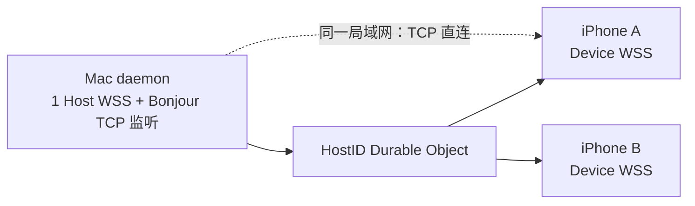
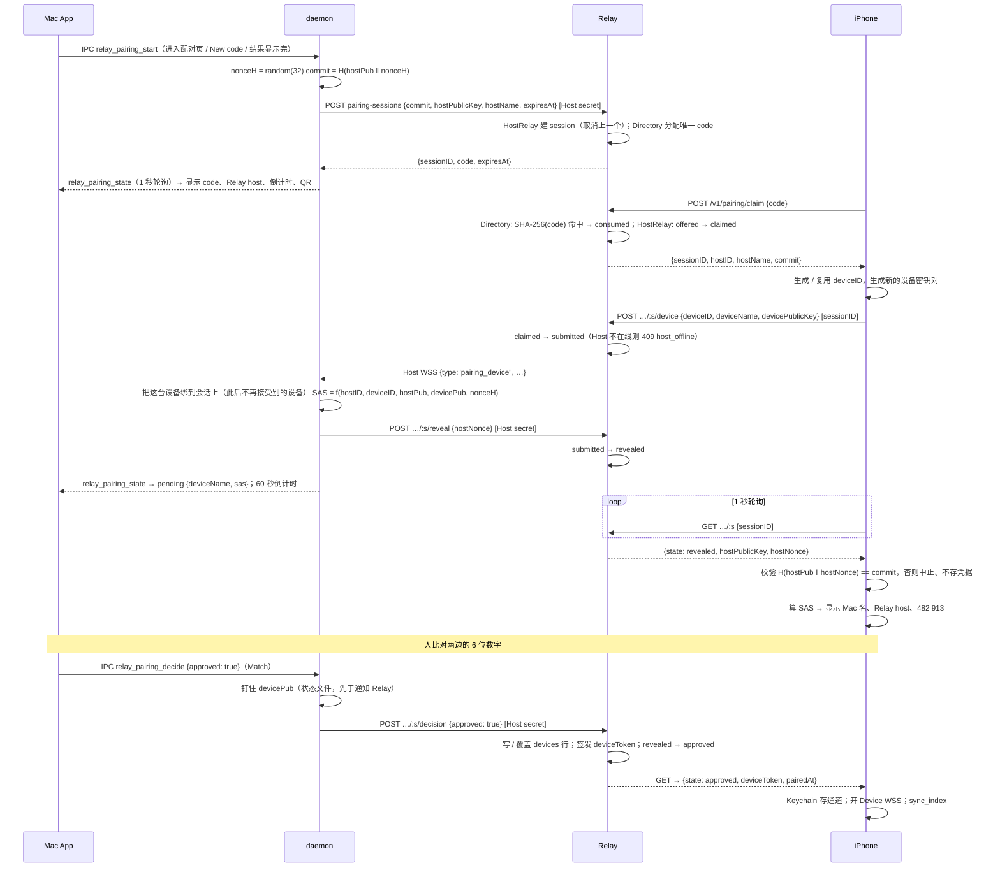

# Relay、配对与安全设计

Relay 使用 TypeScript Cloudflare Worker 和 Durable Objects。每个 `HostID` 映射到一个 `HostRelay` Durable Object；另有一个全局的 `PairingDirectory` 对象，只回答“这个配对码属于哪台 Mac”。业务 payload 在 Mac 的 daemon 加密、iPhone 解密（设备请求反向同理），Relay 只理解路由头。

威胁模型按“Relay 可能作恶”设计：Relay 只搬运，不裁决。三件事都由两端自己决定。

| 问题 | 谁决定 | 怎么决定 |
| --- | --- | --- |
| 这把钥匙是谁的 | 人，在 Mac 上 | daemon 先对自己的公钥做承诺，iPhone 的公钥到了才揭示 nonce，两端各算出同一组 6 位数字（SAS），比对后点 Match。Relay 换钥匙只有一次 10⁻⁶ 的盲猜机会，失败在两块屏幕上可见 |
| 信任哪台 iPhone | daemon 的状态文件 | Match 钉住公钥，Revoke 去掉。Relay 的设备列表只用于显示，它回什么都不能让一台设备（重新）被信任 |
| 哪一帧算数 | 收帧的那一端 | 每次同步两端各出一把一次性钥匙，派生出只在内存里的会话密钥。一帧只在当前会话里验证通过、且序号向前时才生效 |

## 选择 Durable Objects 的原因

- 同一台 Mac 的 Host socket、Device sockets、授权、配对会话和序号在一个单线程对象内协调。
- `getByName(hostID)` 提供稳定路由，不需要全局在线注册表。
- 配对码必须全局唯一，所以只有一个全局对象 `PairingDirectory`；它只存 SHA-256(code) → Host / session，不知道公钥、承诺或设备。
- WebSocket Hibernation 允许空闲连接不持续占用 Worker 计算。
- Durable Object SQLite 适合保存少量授权、配对会话和限流元数据。
- 不需要 KV、D1 或 R2 保存 Session 内容。

## 连接拓扑

- 一个 daemon 同时只保留一个 Host WSS；新 Host 连接会关闭旧 Host 连接。Mac App 不持有 Relay 凭据或连接，只经 IPC 驱动 daemon。
- 一台 iPhone 对每台已配对 Mac 建立一个 Device WSS，并始终保持；同一局域网上看到这台 Mac 的 Bonjour 服务（`_lumi-relay._tcp`，TXT 带 hostID 与协议版本）时再建一条 TCP 直连。
- 逻辑通道按 Mac—iPhone 设备对划分；Host WSS 可以多路复用全部通道。
- **一个通道会话只走一条链路**：`sync_index` 从哪条链路发出，这个会话的每一帧就只走哪条。iPhone 直连建立后立即在直连上开新会话（Relay 从此不再为这台 Mac 承载任何内容），直连断开后在 Relay 上再开一次。daemon 记住每个会话的链路，直连连接关闭时丢掉绑在它上面的会话。
- 直连是明文 TCP：帧本身用会话密钥 AEAD 密封并认证，握手帧用握手密钥，局域网上的任何人读不到、改不了、冒充不了；Bonjour 广播只是地址，不是信任，iPhone 只有收到合法的 `channel_opened` 后才把直连算作可用。daemon 对未认证的 TCP 对端只做资源保护：单条记录 2 MiB、最多 16 条连接、90 秒没有合法帧就关闭。
- 所有 Session 复用通道，不建立 Session WSS。

## Relay 地址

- **Mac**：Relay URL 是 daemon 的启动配置（`Shared.xcconfig` → Info.plist），界面上不可改。配对页、二维码和 daemon Keychain 用的都是它。
- **iPhone**：没有全局唯一的 Relay。每条 Mac 通道在配对时记下自己的 Relay URL（Keychain），REST / WSS 各用各的地址；一台 iPhone 可以同时连着两个不同 Relay 上的 Mac。
- **配对时怎么来**：二维码 / 链接 `lumi://pair?relay=<https URL>&code=<6 位>` 直接给出；手输时默认内置 Relay（`relay.lumi.huanan.app`），Add Mac › Advanced 可改。上次填过的地址只作下次预填（`LocalSettings`），不参与信任。
- **校验**：`https`、有 host、无 userinfo / query / fragment、host 小写、去尾 `/`、≤ 256 字符；DEBUG 构建额外放行 `http://localhost` / `http://127.0.0.1`（`wrangler dev`）。
- **Worker 侧也拒绝明文**：非 `https` 的请求一律 `403 https_required`（只放行 loopback，给 `wrangler dev`）。所有凭据都是 bearer token，不能出现在明文连接上；workers.dev 本身不做 http→https 跳转，所以由 Worker 自己拒。
- **地址不承载信任**：指向攻击者 Relay 的二维码最多让 iPhone 配上一台“假 Mac”，碰不到真 Mac 的通道——所以每个配对界面都显示 Relay host。

## REST 接口

| Method | Path | 鉴权 | 作用 |
| --- | --- | --- | --- |
| `GET` | `/health` | — | 返回状态和 protocol major |
| `PUT` | `/v1/hosts/:h` | — | 注册 Host secret（幂等，同 secret 返回 200；只存 SHA-256） |
| `POST` | `/v1/hosts/:h/pairing-sessions` | Host secret | daemon 建配对会话：`{commit, hostPublicKey, hostName, expiresAt}` → `{sessionID, code, expiresAt}`；同一 Host 之前没结束的会话一律 cancelled |
| `POST` | `/v1/pairing/claim` | 无（限流） | iPhone 花掉配对码：`{code}` → `{sessionID, hostID, hostName, commit}`；码错 / 过期 / 用过 → `404 invalid_or_expired_code`；超限 → `429 rate_limited` |
| `POST` | `/v1/hosts/:h/pairing-sessions/:s/device` | Bearer sessionID | iPhone 提交 `{deviceID, deviceName, devicePublicKey}`；Host WSS 不在线 → `409 host_offline`（会话留在 claimed，可重试） |
| `GET` | `/v1/hosts/:h/pairing-sessions/:s` | Bearer sessionID | `{state, hostName, hostPublicKey?, hostNonce?, deviceToken?, pairedAt?}`，字段随 state 逐步出现；iPhone 1 秒轮询 |
| `POST` | `/v1/hosts/:h/pairing-sessions/:s/reveal` | Host secret | daemon 揭示 `{hostNonce}`，只接受 submitted 状态 |
| `POST` | `/v1/hosts/:h/pairing-sessions/:s/decision` | Host secret | `{approved}`：true → 写 / 覆盖 `devices` 行并签发 Device token；false → rejected |
| `DELETE` | `/v1/hosts/:h/pairing-sessions/:s` | Host secret 或 sessionID | 任一端取消 |
| `GET` | `/v1/hosts/:h/devices` | Host secret | 列出设备、公钥、配对与撤销时间 |
| `DELETE` | `/v1/hosts/:h/devices/:d` | Host secret | 撤销单台设备并关闭其 socket；加 `?purge=1` 则删除这条记录（Mac 在 Revoked 行点 Remove，daemon 同时忘掉钉住的钥匙） |
| `PUT` | `/v1/hosts/:h/devices/:d/push-token` | Device token | iPhone 注册 / 更新 APNs token：`{token, environment}`（environment 是 `production` / `development`，跟随构建的 aps-environment） |
| `DELETE` | `/v1/hosts/:h/devices/:d/push-token` | Device token | iPhone 解绑时尽力清掉自己的 APNs token |
| `POST` | `/v1/hosts/:h/notifications` | Host secret | daemon 请求推送：`{deviceIDs?, title, subtitle, sessionID?, collapseID?}`（title 是 Session 标题，subtitle 是状态词）→ 每台设备一个结果（`sent` / `no_token` / `revoked` / `unregistered` / `failed`）；Relay 签 ES256 provider JWT 后转发 APNs，文本不落存储不落日志 |
| `GET` | `/v1/hosts/:h/ws` | Host secret / Device token | 升级 Host 或 Device WebSocket |

非法状态跳转一律 `409 invalid_state`。sessionID 是 128 bit 随机 base64url，既是会话 ID 也是 iPhone 在这次配对里的 capability（timing-safe 比较）。

Host WSS 多两种控制帧（与 `presence` / `error` 同一通道）：

- `{type:"pairing_device", sessionID, deviceID, deviceName, devicePublicKey}`：iPhone 提交了设备。
- `{type:"pairing_closed", sessionID, reason:"cancelled"|"expired"}`：iPhone 取消了，或 Relay 在访问时发现会话过期。只在 daemon 已经看到设备（submitted / revealed）后才发。

## 配对流程

Relay 侧会话状态单向：`offered → claimed → submitted → revealed → approved | rejected | cancelled | expired`。claimed = 码已被花掉；submitted = 设备信息已进来；revealed = daemon 已揭示 nonce。

### daemon 的会话阶段

daemon 自己的配对会话只往前走：

| 阶段 | 含义 | 能做什么 |
| --- | --- | --- |
| `offered` | 码在屏幕上，nonce 还是秘密 | 唯一接受 `pairing_device` 的阶段 |
| `revealing` | 设备已绑定，nonce 正在发给 Relay | 什么都不显示，不能 Match |
| `comparing` | Relay 收下了 nonce，SAS 在屏幕上 | Match / Don't match，60 秒 |
| `decided` | Paired 或 Pairing declined | 等 Mac 显示完结果后开新码 |
| `expired` | 码到期 | 停在 Expired，等 New code |

没有任何路径回到 `offered`。三条规则由此而来：

- **一个会话只绑一台设备。** 第一条 `pairing_device` 把设备身份和公钥绑死；同一会话后来的 `pairing_device` 一律忽略（`pairing_device_ignored`）。
- **nonce 一旦尝试发出就算已披露。** reveal 请求失败不代表 Relay 没收到 nonce。所以 reveal 无论因何失败，daemon 都丢弃整个会话（尽力通知 Relay 取消），Mac 回到一个新码、新 nonce；iPhone 看到会话被取消，回输码屏。会话绝不退回“还能换设备”的状态。
- **揭示不阻塞同步。** reveal 作为独立任务执行，Relay 慢或不应答时不会卡住其他 iPhone 的帧。

### 其余规则

- **配对码**：6 位 Crockford Base32（`0-9 A-Z` 去 I L O U，30 bit），由 `PairingDirectory` 生成并保证与活跃码不撞；5 分钟；单次；输入归一化（大写、去空格 / 连字符、`O→0`、`I→1`、`L→1`、`U→V`）。码不参与任何密钥。
- **状态机在 daemon**：Mac App 退出不影响进行中的配对；daemon 重启 = 内存会话丢失，Relay 侧会话到期自然作废，重开配对页即可。
- **Mac 侧节奏**：配对页可见时 1 秒轮询 `relay_pairing_state`；新码只由人触发（进入页面、New code、一次结果显示完），不按时间续码；离开页面 `relay_pairing_cancel`，码立刻作废。
- **到期**：daemon 的 5 分钟定时器（或 Relay 的 `pairing_closed{reason:"expired"}`）把会话标为 expired、清掉等待中的 iPhone，但保留会话；`relay_pairing_state` 带 `expiredAt`，Mac 显示 Expired，直到用户点 New code 或离开页面。配对页开着没人配对时，不再每 5 分钟向 Relay 建一次会话。
- **超时**：pending 60 秒无人点 → daemon 自动 `decision{approved:false}`，iPhone 看到 rejected。
- **取消**：iPhone 取消 → Relay 给 daemon `pairing_closed{reason:"cancelled"}`，daemon 丢掉该会话，Mac 不显示结果、直接开始新码。结果态只有 Paired / Pairing declined，停 2 秒后卡片收起、新码开始。
- **失败不落盘**：iPhone 任何一步失败都不写 Keychain。

### 钥匙为什么不信 Relay

- **承诺先行**：`commit` 在会话创建时就交给 Relay（iPhone claim 时拿到），nonce 只在 daemon 收到 `pairing_device` 之后才揭示。Relay 想换钥匙，必须在没见过 devicePub 时伪造 `commit'`，又在不知道 nonceH 时伪造 `devicePub'`——两边的 SAS 在它能“适应”之前已被钉死，碰巧相等的概率 10⁻⁶。没有承诺的 6 位 SAS 可以离线枚举凑出来，所以 reveal 必须等 devicePub 到了之后，而且 devicePub 定了就不能再换（见上面的会话阶段）。
- **iPhone**：每次配对尝试生成新的设备密钥对，Relay 无法预知。`revealed` 时校验 `commit`，不符即中止（界面“校验失败”，红色）、不存任何凭据、DELETE 会话。Host 公钥以校验通过的那把为准。
- **Mac**：Match 时 daemon 先把 `pairing_device` 里的设备公钥写进状态文件（钉住），再把决定告诉 Relay；写不进去就不告诉 Relay，Relay 拒绝决定就把记录恢复原样——但等 Relay 应答期间做出的撤销不会被这次恢复撤回。此后 daemon 只用钉住的这把公钥派生通道密钥，Relay 列表里的公钥从不参与。
- **Device token**：只在 Mac `decision{approved:true}` 后签发；Relay 拿着 token 冒充 iPhone 也解不开帧、SAS 也对不上。
- 升级前配对的设备在状态文件里没有钉住值 → Unverified，重新配对即可（deviceID 复用）。

## 密钥与加密

一条 Mac—iPhone 通道有三层钥匙，寿命从长到短：

| 钥匙 | 从哪来 | 活多久 | 封什么 |
| --- | --- | --- | --- |
| 长期密钥对 | 每端各一对 Curve25519 Key Agreement；公钥在配对时经承诺 + SAS 交换 | 这次配对存续期间；重新配对换新 | 不直接封帧 |
| 握手密钥 | 两把长期密钥做 X25519 → HKDF-SHA256 | 同上 | 只封打开通道会话的两帧：`sync_index` 和 `channel_opened`，里面没有 Session 内容 |
| 会话密钥 | 两把长期密钥 + 两把一次性密钥，四个 X25519 结果 → HKDF-SHA256 | 一个通道会话，只在两端内存里 | 其余所有帧 |

### 通道会话

每次 `sync_index` 打开一个新的通道会话。帧格式不变，Relay 不参与也察觉不到：

1. iPhone 生成一次性密钥对，把公钥 `E_d` 和随机 `requestID` 放进 `sync_index`，用握手密钥封好发出。
2. daemon 生成自己的一次性密钥对，算出会话密钥，回一帧用握手密钥封的 `channel_opened{requestID, E_h}`，紧接着是用会话密钥封的 index。
3. iPhone 核对 `requestID` 是自己这次发的，算出同一把会话密钥。之后两个方向的帧都用它封。

会话在这些时候结束，钥匙随之丢弃：任一端重连、Mac 离线、iPhone 发出下一次 `sync_index`、设备不再被信任。

### 派生公式

`RelayCryptography`，两端同一份实现：

- **握手密钥**：`HKDF-SHA256(ikm = X25519(长期, 长期), salt = "Lumi Relay/v2/handshake", info = hostID "/" deviceID)`，64 字节。
- **会话密钥**：`HKDF-SHA256(ikm = DH1 ‖ DH2 ‖ DH3 ‖ DH4, salt = "Lumi Relay/v2/session", info = hostID "/" deviceID ‖ 0x00 ‖ E_d ‖ E_h)`，64 字节。

  | | Mac 一侧 | iPhone 一侧 |
  | --- | --- | --- |
  | DH1 | 长期 | 长期 |
  | DH2 | 长期 | 一次性 |
  | DH3 | 一次性 | 长期 |
  | DH4 | 一次性 | 一次性 |

- **分方向**：64 字节前一半封 `data`（daemon → iPhone），后一半封 `request`（iPhone → daemon）。
- **封帧**：`RemoteSessionPayload` 明文先 zlib 压缩，再用 ChaChaPoly 加密和认证（随机 96 bit nonce），路由头（`HostID`、`DeviceID`、`sequence`、`kind`）作为 additional authenticated data 一起认证。

配对派生（Swift 与 Relay 的 TS 各算一遍、黄金向量相等）：

- `nonceH`：32 字节随机。
- `commit = SHA256("Lumi Relay/pair-commit/v1" ‖ hostPub ‖ nonceH)`。
- `SAS = SHA256("Lumi Relay/pair-sas/v1" ‖ hostID ‖ deviceID ‖ hostPub ‖ devicePub ‖ nonceH)` 取前 4 字节 big-endian `mod 1 000 000`，补零 6 位，显示 `482 913`。
- SAS 不混入 Relay URL（攻击者本来就控制 Relay），也不混入 Device token（那时还不存在）。

### 保证什么

- **只有配对的两端算得出会话密钥。** 两把长期密钥都参与派生（DH1–DH3），握手帧本身也只有它们封得出来。
- **前向保密。** 会话结束、两把一次性私钥丢弃后，哪一端的长期私钥日后泄露都还原不出这个会话的密钥（DH4 需要一次性私钥）。握手帧里的一次性公钥届时能被读到，但公钥推不出 DH4。
- **只拿到一端的长期私钥，冒充不了另一端。** 冒充 Mac 需要 DH2，冒充 iPhone 需要 DH3，各自要用到对方没泄露的那把私钥。
- **跨会话的帧互不相通。** 每个会话的钥匙不同，留着以前会话的帧，在后来的会话里解不开。
- **Relay 改不了帧。** 改 `sequence`、改 `kind`（换方向）或改 ID，接收端都验证失败；两个方向还各用一把钥匙。

### 不保证什么

- **会话存活期间的内存。** 会话密钥在两端内存里；一端在会话期间被完全控制，这个会话的内容对它是明的。
- **长连接不主动换钥匙。** 钥匙随 `sync_index` 换（连上、Mac 重新上线、回到前台、下拉刷新、序号断档）；一条连接一直不断、其间又没有这些事件，就一直用同一把。
- **升级前的流量。** 通道会话上线之前的帧是用长期密钥直接派生的钥匙封的，被录下的旧流量仍随长期私钥泄露而暴露。重新配对才换长期密钥。
- **两把长期私钥同时泄露。** 等同于攻击者就是两端；之后的会话可以被冒充，之前已结束的会话仍然安全。
- **版本不一致。** 两端必须都支持通道会话。只更新了一端时两边互相解不开，不会降级成旧协议：daemon 记 `request_open_failed`；iPhone 的 index 请求超时重试，Macs 页仍显示 Online、Session 不再更新，界面上没有提示。

每个 routing frame 包含：

- protocol version
- HostID
- DeviceID
- sequence
- kind（`data`：daemon → 设备；`request`：设备 → daemon）
- nonce
- ciphertext + authentication tag

Relay 能看到 routing header、帧大小、连接时间和流量模式；看不到 `RemoteSessionPayload` 的任何字段（kind、index、events…），也分不出握手帧和会话帧。

## 凭据保存

### daemon Keychain（service `app.huanan.lumi.daemon.relay`）

- Relay URL
- Host ID
- Host secret
- Host private/public key

Keychain 项由 daemon 进程自己创建，因此 daemon 在该项 ACL 内，之后读写不弹窗；Mac App 不读它。

### daemon 状态文件（`relay-host-state.json`，0600）

- 每个 Device ID 的发送 sequence（发送前先落盘）
- 被信任的设备：Device ID → Match 时钉住的公钥。有这一条就是被信任，没有就不是；daemon 决定“收不收、发不发”只读这里
- 本机的撤销记录：Device ID → 撤销时间。只用来把这一行显示成 Revoked，以及在 Relay 还没照办时继续补发撤销

每次改动先写盘、再生效：写不进去就报错，文件和内存都保持原样，所以 daemon 当下依据的状态就是重启后会读到的状态。升级前的文件没有撤销记录，按“没有撤销过”读入。

配对会话本身（sessionID、code、nonceH、pending 设备）只在 daemon 内存；通道会话的钥匙和一次性私钥只在两端内存。

### iOS Keychain（account `device-channels-v4`）

- 每台 Mac 各自的 Relay URL、Host ID 和显示名
- Device ID 和 Device token
- Device private/public key
- Host public key（`revealed` 时取得、经承诺校验）
- 配对时间

### Relay Durable Object SQLite

`HostRelay`（每 HostID 一个）：

- Host token hash
- `devices`：Device ID、名称、公钥、token hash、配对与撤销时间、APNs token 与环境（schema v2 迁移新增；撤销或 APNs 报 410 时清空）
- `pairing_sessions`：state、commit、Host 公钥与名称、reveal 后的 nonce、设备 ID / 名称 / 公钥、approve 后的 Device token hash 与明文 token（留给 iPhone 下一次轮询领取，只有 sessionID 持有者可读；会话到期后由 alarm 连整行删除）、创建 / 到期 / 更新时间
- 每个设备最后 Host sequence
- 基于来源地址 hash 的限流窗口

`PairingDirectory`（全局一个）：

- `pairing_codes`：SHA-256(code)、host_id、session_id、到期与消费时间（每次写入顺手删过期行）
- claim 限流窗口

Relay 不持久化帧 nonce、ciphertext、Session、Timeline 或用户消息。配对过程中它额外看到 hostName、设备名、两把公钥、承诺和揭示后的 nonce；拿不到任何一端的私钥，算不出通道密钥，Host secret 只有 hash。

### 推送通知：明文例外与设备端解密

推送通知是唯一的明文例外：daemon 把一条短通知（Session 标题 + 状态词，各有长度上限）连同 Session ID 以明文交给 Relay 转发 APNs。它只存在于该请求的内存里——不写存储，日志只记设备、结果、环境和文本长度，从不记文本本身。Session 的完整内容仍然只走端到端加密通道。

明文是产品取舍，不是技术限制。iOS 可以让通知在设备端解密后再显示（Apple：[Modifying content in newly delivered notifications](https://developer.apple.com/documentation/usernotifications/modifying-content-in-newly-delivered-notifications)，“解密”是文档列出的第一个用途）：

| 环节 | 现在（明文） | 设备端解密 |
| --- | --- | --- |
| daemon | 把标题、状态词明文交给 Relay | 用这条通道的钥匙封好标题、状态词，交给 Relay 的是密文 |
| Relay / APNs | 看得到标题和状态词 | 只看得到密文和一句不含内容的占位文案 |
| iPhone | 系统直接显示 | 通知带 `mutable-content`；系统在显示前交给 App 内的 Notification Service Extension，扩展解开后写回标题和状态词 |

要落地还需要：

- **扩展拿得到钥匙。** 扩展是独立进程，通道钥匙要放进它与 App 共享的 Keychain 访问组。
- **解不开时的回退。** 扩展大约有 30 秒；超时、读不到钥匙（例如重启后首次解锁之前）、钥匙已因重新配对换掉时，显示占位文案（如 `A session needs your attention`）。
- **接受两条限制。** 扩展只处理会显示 alert 的远程通知，用户关掉提醒就不经过它；通知是单向的、没有握手，只能用长期密钥派生的钥匙封，拿不到通道会话那样的前向保密。
- **元数据仍然可见。** 即使内容加密，Relay 和 APNs 仍知道通知发给哪台设备、什么时候、多长，以及用于折叠的 Session ID（除非一并换成不可关联的标识）。

当前没有实现设备端解密：Relay 与 APNs 能读到 Session 标题和状态词，这两项不在“Relay 读不到正文”的保证范围内。

## 序号、重放与重连

两个方向都由收帧的一端自己防重放，不依赖 Relay 记的序号。规则只有一条：**一帧先验证、后生效，序号只在验证通过后推进。**

| 方向 | 序号从哪来 | 接收端怎么判 |
| --- | --- | --- |
| daemon → iPhone（`data`） | daemon 对每台被信任的 iPhone 独立递增，区间先写入状态文件再发送 | iPhone 只接受能用当前会话密钥解开、且序号大于本会话已验证最大值的帧 |
| iPhone → daemon（`request`） | iPhone 每条连接从 1 递增，按封帧顺序逐条发出 | daemon 只接受能用该设备当前会话密钥解开、且序号大于本会话已接受最大值的请求；重复或更早的丢弃（`request_replayed`） |

由此：

- **重放同一会话里的帧**：序号不向前，丢弃。
- **重放以前会话的帧**：钥匙不同，解不开，什么都不变。重连、Mac 上下线都不会让旧帧重新生效——挡住它们的是钥匙，不是一个可以被清零的游标。
- **伪造的高序号帧**：验证不过，游标不动，之后的正常帧照常接受。
- **会话外的请求**：用握手密钥封的帧只有 `sync_index` 被接受（它打开新会话）；其余一律丢弃（`request_outside_channel_session`）。
- **重放 `sync_index`**：当前会话的那条开场帧再来一次，daemon 不理会（`channel_opening_repeated`）。更早的开场帧被重放时，daemon 会为它开一个没人能用的会话、替掉现有会话，直到 iPhone 下一次 `sync_index`。只影响可用性——Relay 本来就能丢帧——不改变任何数据，重放者也拿不到会话密钥。

重连与补齐：

- Durable Object 拒绝同一设备通道非单调的 Host sequence，并把该通道当前序号回给 daemon（`non_monotonic_sequence{deviceID, lastSequence}`）。这个游标只在对象内存里：对象休眠或迁移后以收到的第一帧为新基线——它只是多一道告警，两端各自的会话密钥 + 会话内序号才是防重放的边界，而写存储会让每一帧都等一次持久化提交。被拒的可能正是 `channel_opened`，而 Relay 不会替 daemon 通知设备，所以 daemon 抬高序号后把这个会话重新打开一遍（`channel_opened` + index）：还在等的 iPhone 拿到钥匙和 index，已经有钥匙的 iPhone 看到序号断档、重新 `sync_index`。
- 通道序号的上限是 2⁵³——Relay 自己能精确计数的最大值。Relay 回报的序号达到或超过它时 daemon 不采信（`sequence_heal_refused`），沿用自己的序号：否则一条消息就能把这条通道的序号耗尽。
- 会话正在打开时发生的变化不会丢：推送照常入队，排在这个会话的 index 之后发出。
- iPhone 看到序号空洞，处理完本帧后重新 `sync_index`。
- iPhone 开新会话时，还没等到应答的请求（尾页、翻页、补尾、取条目、usage）带进新会话重发；会话正在打开期间发起的请求排队，会话一开按顺序发出。
- 活性不靠对方的帧：两端对各自的 WebSocket 每 10 秒发一次协议级 ping（Relay 的运行时自动应答，不唤醒 Durable Object），30 秒无 pong 即判断线并重连，重连间隔 2 → 4 → 8 → 16 → 30 秒。直连 TCP 没有 ping，靠系统 keepalive 与 daemon 侧的 90 秒空闲关闭。
- 旧版客户端（文本路由帧）被 Relay 以 4004 关闭；新版客户端把 4004 当作不可重试，提示更新，不再每 2 秒重连。
- 没有 ACK，没有 hello：iPhone 有本地缓存，恢复路径永远是“再要一次 index，按差异补”。
- Relay 不保留重放缓冲：离线设备错过的帧由下一次 index 对账补齐。

## 在线状态

- Host WSS 建立：Relay 向所有 Device sockets 广播 `presence: online`。设备行变化（配对批准、撤销、push token）时 Relay 另向 Host 推 `devices_changed`，daemon 据此刷新设备列表，不再每 10 秒轮询。
- 直连上没有 presence：连接在就是在线，断了就是离线；会话绑在直连上时 Relay 的 presence 不改变任何东西。
- 最后一个 Host WSS 关闭：广播 `presence: offline`。
- Device WSS 建立：立即收到当前 Host 是否在线。
- iOS 收到 offline 后把该 Mac 标为 Offline、结束当前通道会话，继续显示缓存；收到 online 立即重新 `sync_index`（daemon 重连后不再持有任何会话）。

presence 是 Relay 的一面之词，没有认证：它只决定 iPhone 什么时候去问，不决定 iPhone 接受什么。谎报在线状态最多让 iPhone 多开一次会话。

Host WSS 属于 daemon：Mac App 退出不影响在线状态；daemon 被 launchd 重启时 presence 短暂翻转，iPhone 自动重新对账。

## 撤销

撤销先在这台 Mac 上生效，再同步给 Relay；Relay 配合与否都不影响结果。

1. daemon 把撤销写进状态文件：去掉钉住的公钥，记下撤销时间。写不进去就报错、什么都不变。
2. 该设备的通道会话立即结束；之后它的请求被丢弃（`request_from_untrusted_device`），帧和推送提醒都不再发给它。正在发送途中的一批帧就地停下（`send_stopped_device_untrusted`），不会发完。
3. daemon 通知 Relay：Durable Object 写入 `revoked_at`、清空该设备的 APNs token、以 close code `4003` 关闭它的所有 WSS，后续 Device token 鉴权失败（握手 401）。
4. iPhone 把握手 401 / 403 和 close code `4003` 识别为“凭据被拒”：该通道进入 Revoked 态并停止重连，Macs 页显示 `Revoked · <relay host>`，缓存保留可读。
5. 其他设备的授权和连接不变。

Relay 不能让撤销失效：

- **Relay 没收到或不照办**（连不上、报错、继续把设备列为有效）：这一行在 Mac 上仍是 Revoked，daemon 每次刷新设备列表都会补发撤销（`device_revocation_unapplied`），直到 Relay 照办。
- **Relay 之后改口**：列表里出现“未撤销 + 原公钥”不恢复信任——钉住的公钥已经没了。
- **daemon 重启**：撤销在状态文件里，重启后依旧。
- **升级前撤销的设备**：Relay 列为已撤销、公钥又正是本机钉住的那把时，daemon 把这次撤销记成自己的（`device_revocation_adopted`）。Relay 只能这样收回信任，不能给出信任。

恢复访问只有一条路：重新配对并在 Mac 上点 Match。重新配对同一台 Mac 复用原 Device ID——Match 时 daemon 钉住新公钥并解除撤销记录，Relay 覆盖同一条 `devices` 行（新公钥、新 token、撤销标记清除，不会出现第二台 Active）。Mac 在 Revoked 行点 Remove 则删除 Relay 的记录，daemon 同时忘掉这台设备的公钥和撤销记录。

iPhone 本地“Remove”只删除自己的 Keychain 通道、SQLite 缓存文件和 WSS；不会替 Mac 撤销 Relay 设备记录。

## 输入限制与滥用保护

- Host/Device ID：8..128 位字母、数字、下划线或连字符。
- HTTP JSON body：最大 64 KiB。
- WebSocket message：最大 2 MiB，只接受 JSON text。
- 边缘限流：Worker 在碰任何 Durable Object 之前，先按客户端地址用 Workers Rate Limiting binding（`wrangler.jsonc` 的 `RATE_LIMITER`）限每分钟 300 次，超限 `429 rate_limited`。没有 `cf-connecting-ip` 的请求（本地 / 内部调用）不计。对象内的限流只有进了对象才开始计数，而进对象本身已经要花一次调用、对陌生 Host ID 还要建一个对象——边缘这层挡的就是这个。
- “来源”的定义（边缘和对象内一致，`sourceBucket`）：IPv4 按地址；IPv6 按 /64——一台主机能随手换 2⁶⁴ 个地址，按单地址计等于没限。
- 注册 Host：每来源每分钟 10 次（按 Host 对象计）。
- 配对码：6 位 Crockford Base32，Directory 只存 SHA-256(code)；5 分钟到期、单次消费；`claim` 每来源每分钟 5 次、全局每分钟 600 次（对错都计数，猜码只能走这一个口）。全局上限是两种风险的折中：调低挡分布式猜码，调高防几个地址把所有人的配对锁死；600/分钟对 30 bit、5 分钟的码是 ≤ 3000 次 / 码（≈ 3×10⁻⁶），打满需要 120 个不同的 IPv4 地址或 IPv6 /64。
- 配对会话：每 Host 每分钟最多建 10 个；同一 Host 同时只有一个活会话（新建即取消上一个）；Relay 接受的最长有效期 10 分钟（daemon 用 5 分钟）；过期会话在下一次访问时标 expired。每个 Host 对象在最新会话到期后 1 秒触发 alarm：仍未结束的会话按正常路径关闭（释放码、通知 daemon），所有已到期的行整行删除——approved 行里的明文 Device token 也随之消失。
- 限流窗口按 key 记在 DO SQLite，开新窗口时顺手删掉 10 个窗口期之前的旧行。
- Device 只允许发送密封的 `request` 帧（`sync_index` / `fetch_session` / `fetch_timeline_since` / `session_reviewed`，Relay 读不到是哪一种）；其他 kind 关闭为只读违规（1008）。解析失败（缺少 nonce / ciphertext、ID 不合规）回 `{type:"error",code:"invalid_frame"}` 不关闭；转发到对端失败只记日志（`ws_forward_failed`，见[日志设计](logging.md)），不算发送方的错误，序号照常推进。
- 协议 major 不是 1 时拒绝 frame。

## 安全边界与当前缺口

| 风险 | 当前控制 | 剩余边界 |
| --- | --- | --- |
| Relay 读取正文 | 端到端 ChaChaPoly | Relay 仍观察路由元数据、Host / 设备名、两把公钥、承诺与 nonce、IP、帧大小和 `data` / `request` 方向，但读不到请求或载荷类型 |
| 路人猜码 | 30 bit、5 分钟、单次、claim 限流（全局 600/分钟 → ≤ 3000 次 / 窗口 → ≈ 3×10⁻⁶）；猜中仍要过 Mac 的 Match | 可忽略 |
| 占满全局 claim 限流锁死配对 | 每来源按 IPv6 /64 聚合 + 全局 600/分钟 | 仍需 ≥ 120 个不同地址 / /64 持续打满；手里有 /48 的攻击者做得到，代价是一场可观测的 429 风暴（`pairing_claim_rate_limited`） |
| 偷看屏幕抄到码 | 能走到提交设备，但 Mac 弹“陌生 iPhone wants to pair”且默认焦点在 Don't match | 用户误点 Match |
| Relay 换钥匙（MITM） | 承诺 + SAS：一次盲猜 10⁻⁶，失败可见；一个配对会话只绑一台设备，reveal 失败即整个作废，nonce 披露后无法再换设备；daemon 只用 Match 时钉住的公钥，Relay 列表里的公钥不参与 | 用户不比对数字直接点 Match |
| Relay 冒充 iPhone 取 token | token 只在 Mac `decision{approved}` 后签发、绑定 Mac 看到的 devicePub；Relay 换 devicePub 则通道密钥和 SAS 都对不上 | — |
| 恶意 QR / 链接指向攻击者 Relay | 攻击者 Relay 没有真 Mac 的 code / Host secret，只能扮演“假 Mac”推假数据；iPhone 泄露的只有设备名、设备公钥和 `session_reviewed` 的 session ID；每个界面显示 Relay host | 用户被假数据误导 |
| 凭据泄露 | Host secret 只存 hash；端点凭据在 Keychain；配对会话在 daemon 内存；approved 行的明文 Device token 随会话到期被 alarm 删除 | 到期前 sessionID 持有者可读 token（token 本身解不开任何帧，拿它只能开一个只收密文的 device socket） |
| 明文 http | Worker 拒绝非 https（loopback 除外）；两端客户端只生成 https 地址 | — |
| Host ID 被抢注 | 首次 `PUT` 即占、之后只认同一 secret；ID 122 bit 随机不可枚举 | 只有 Relay 存储被重置（删 DO class / 换 namespace）后，知道 ID 的人（如已撤销的旧 iPhone）才可能抢先；生产不要做这种迁移。撞上时 daemon 记 `relay_host_identity_rejected` 并停止重连 |
| 重放 / 乱序 / 路由头篡改 | 路由头为 AEAD AAD；每个通道会话一把钥匙；两个方向都由接收端校验序号，先验证、后推进；presence 不影响接收状态 | 重放旧的 `sync_index` 能让 daemon 白开一个会话，只影响可用性（Relay 本来就能丢帧） |
| 设备被撤销 | daemon 先在状态文件里撤销（去掉钉住的公钥），不受 Relay 的回答和 daemon 重启影响，Relay 不照办就持续补发；Relay 侧 revoked_at + 关闭 socket；iPhone 识别 401 / 4003 进入 Revoked 态并停止重连 | 需重新配对才能恢复（复用 Device ID）；Relay 不照办时旧设备的 socket 可能还开着，但收不到任何新帧、请求被丢弃 |
| 长期私钥日后泄露 | 会话密钥有一次性密钥参与，会话结束即丢弃：已结束会话的内容还原不出来 | 通道会话上线之前录下的流量；通知文本；一条连接不断时不主动换钥匙 |
| 一端长期私钥泄露后冒充另一端 | 会话密钥混入“长期 × 一次性”的两个 DH，只有一把长期私钥算不全 | 两把长期私钥都泄露时无保护 |
| 两端版本不一致 | 不降级：解不开就不同步 | 只更新了一端时同步停住，直到两端都更新；iPhone 仍显示 Online，界面没有提示，只有 daemon 日志里的 `request_open_failed` |
| 大 Session | 2 MiB message 上限 | 载荷按单 Session 发送、明文 zlib 压缩、超预算按 timeline 分片；超大单条 item 只在 Relay 副本中省略 |
| 资源滥用 | 边缘按地址限流（300/分钟，IPv6 按 /64）先于任何 DO；注册 / 建会话 / claim 限流；一 Host 一活会话；ID 正则；body / 消息上限 | 单个地址仍可在限额内用随机 HostID 实例化空 DO（≤ 300/分钟）；大规模分布式洪水交给 Cloudflare DDoS 防护 / 仪表盘里的 WAF 规则；`GET session` 轮询只受边缘限流 |
| 手机后台更新 | APNs 只做提醒（alert push） | 没有静默唤醒 / 后台同步；通知文本对 Relay 和 APNs 明文可见，设备端解密尚未实现（见上文“推送通知：明文例外与设备端解密”），daemon 离线时没有提醒来源 |

## 相关文档

- [整体架构设计](system-architecture.md)
- [数据、通信与保存设计](data-communication-storage.md)
- [App 与运行时设计](application-runtime.md)
